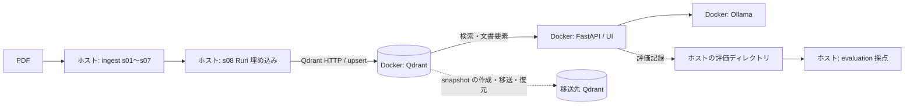

# ホストと Docker の境界

`runtime/compose.yaml` は `qdrant`、`ollama`、`rag-api` を定義し、API のビルドコンテキストは `./rag_api`。Dockerfile はその中の app と static だけをコピーする。Python の実装は `ingest` を import せず、登録済みデータを Qdrant 経由で読む。ホストの `ingest/config.py` は既定で `http://localhost:6333` を使い、Compose は Qdrant をホストのループバックに公開する。`--qdrant-url` により別の到達可能な Qdrant に直接登録もできる（`ingest/run.py`、`ingest/steps/s08_register.py`）。Compose の公開先は 127.0.0.1 なので、別ホストからの直接登録には別途到達経路が必要。

## 接続契約

`runtime/contract/qdrant_schema.json` が正本、`ingest/qdrant_schema.json` が写し。768 次元 Cosine、正規化 Ruri v3、文書と質問で異なる接頭辞、見出し区切り、payload と索引を定義する。`rag_ruri_v3_310m` はチャンクとベクトル、`rag_doc_items` は階層をたどる文書要素。`ingest/qdrant_writer.py` が UUID5 と payload を生成し、`runtime/rag_api/app/qdrant_store/` が読む。全文索引は `embedding_text`、見出し範囲の索引は `heading_paths`。

契約は実行時の共有ライブラリではない。登録側は写しを読む一方、runtime は `app/config.py` と Compose に値を重複して持つ。`tests/test_contract.py` は主要項目を比較するが、文字列の存在や正規表現による静的検査であり、実データ・すべての payload の意味・実際のモデル整合性を保証しない。API イメージは contract 自体をコピーしない。

## データ・モデルの移送と制約

`runtime/qdrant/snapshot.sh` はコレクション単位の作成・ダウンロード・アップロード復元を行う。両コレクションを移送する必要があり、自動同期や二つのスナップショットの一貫した時点の保証はコード上ない。通常データは Compose の名前付き `qdrant_data` にあり、`runtime/` をコピーするだけでは含まれない。移送先で復元または直接登録が必要。既存データがある場合、復元は対象コレクションを置き換える。

Ollama モデルと Hugging Face キャッシュも別ボリュームで、初回取得または別途移送が必要。`ollama/pull_models.sh` はホストの Docker CLI と `.env` を利用する。評価の質問集・記録は `EVAL_HOST_DIR` から常時 bind mount され、既定の `runtime/eval/` には README のみ。記録機能はコンテナ内だが採点・検索比較は `runtime/` 外の `evaluation/` と `data/eval/`、ホストの Python に依存する。したがって RAG の実行コードは概ね切り離されているが、データ・モデルを含む完全なオフライン持ち運びや評価一式の Docker 内完結は実装されていない（`runtime/compose.yaml`、`runtime/eval/README.md`、`evaluation/eval_ragas.py`）。
